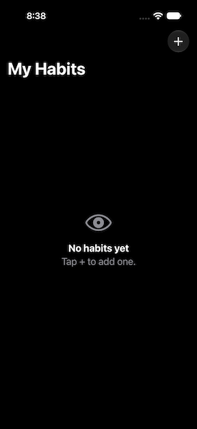
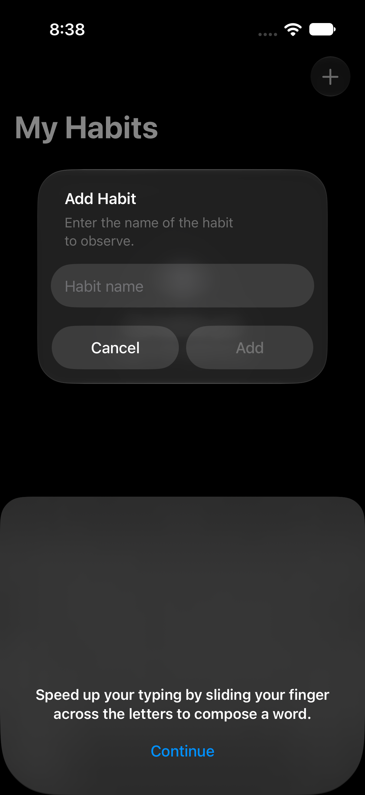
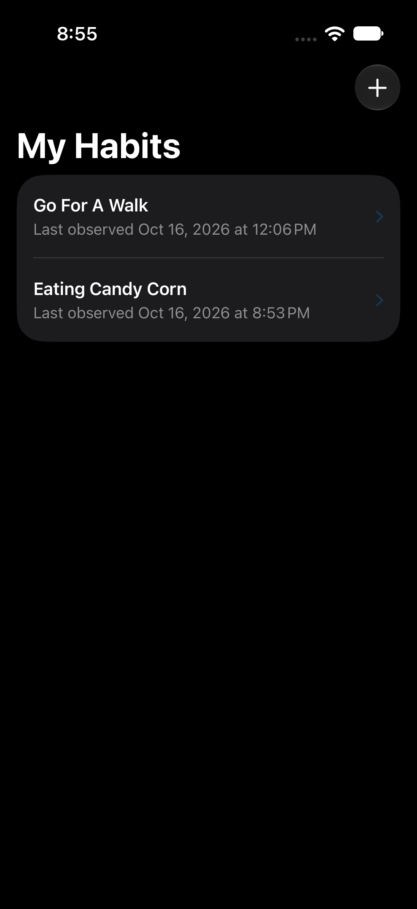
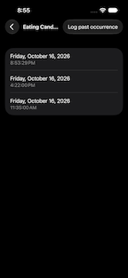
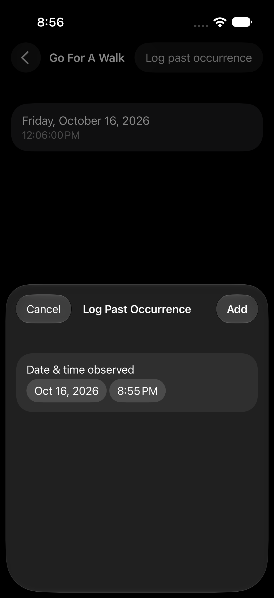

# Observed

[](https://github.com/Lawyneer/Observed-iOS/actions/workflows/ci.yml)
[](#platform--requirements)
[](LICENSE)

A minimal, privacy-first habit observer for iOS. Record what you notice with one
gesture, see when it last happened, and nothing else.

**Observed deliberately has no alarms, reminders, or notifications.** It never
nags you and never interrupts you. It only records what you tell it, when you
tell it. I built this app for myself because I wanted a passive log rather than
spyware or something trying to get me to buy a subscription.

Unlike a conventional habit tracker, Observed doesn't ask you to set goals, hit
targets, or protect streaks. It's for the habits you may not be aware you have —
how often your attention drifts during a task, how long it's been since you last
went for a walk, how frequently a particular mood shows up. Naming the behaviour
is the entire setup. Observing it is the entire point.

## Features

- **Add habits** by name — no account, no schedules, no targets, no clutter.
- **One-gesture logging** — tab a habit row to record an occurrence. Made a
  mistake? An undo toast appears for 5 seconds after logging.
- **Last-observed display** — each habit shows the date and time of the most
  recent occurrence.
- **Full occurrence history** per habit, with swipe-to-delete and a
  confirmation step to guard against accidents.
- **Back-dating** — forgot to log something at the time? Add it with the correct
  past date and time.
- **Cascade deletion** — removing a habit removes its history.
- **On-device storage only** — no network access, no analytics, no tracking.
- **Dark mode** support throughout.

## Screenshots

## Screenshots

|:---:|:---:|:---:|
|  |  |  |
|  |  | |

Left to right, top to bottom: the empty state on first launch, adding
a habit by name, the main list with last-observed times, a habit's
full occurrence history, and back-dating a forgotten entry.

## Non-goals

By design, Observed will likely never have:

- Reminders, alarms, or notifications of any kind
- Streaks, goals, targets, or adherence scoring
- Schedules, quotas, or "did you do it today?" prompts
- Cloud sync or accounts
- Analytics, telemetry, or crash reporting that leaves your device

Anything that turns observation into evaluation is out of scope. If you're
looking for any of the above, Observed is not the right app.

## Platform & Requirements

- iOS 17.0 or later
- iPhone (optimized) and iPad (compatible)
- Built with SwiftUI and SwiftData

## Building from Source

You'll need a Mac with [Xcode 16](https://developer.apple.com/xcode/) or later
(includes the iOS 17+ SDK).

1. Clone the repository:
   ```sh
   git clone https://github.com/Lawyneer/Observed-iOS.git
   cd Observed-iOS
   ```
2. Open the project:
   ```sh
   open Observed/Observed.xcodeproj
   ```
3. Select an iPhone Simulator as the run destination and press ⌘R.

No CocoaPods, Carthage, or SPM dependencies — the app uses only Apple
frameworks.

## Running Tests

The test suite covers the model layer (initialization, last-occurrence
ordering, relationship integrity, cascade deletion) and end-to-end persistence
through in-memory SwiftData stores. Run it locally with ⌘U in Xcode, or let CI
run it on every push and pull request.

## Documentation

- [README](README.md) — this file: overview, features, build instructions
- [Architecture](ARCHITECTURE.md) — how the code is structured and why
- [Contributing](CONTRIBUTING.md) — guidelines for issues and pull requests
- [Changelog](CHANGELOG.md) — release history
- [Privacy policy](PRIVACY.md) — data practices (spoiler: there are none)
- [Security policy](SECURITY.md) — how to report vulnerabilities

The README is the front door; start there. Architecture explains the
reactive loop the whole app runs on and how to extend it without
adding layers; it's the document to read before opening a PR.

## Privacy

Observed collects nothing. All data is stored locally on your device using
SwiftData. There is no network code in the app. See [PRIVACY.md](PRIVACY.md).

## Contributing

Issues and pull requests are welcome — especially Android! See
[CONTRIBUTING.md](CONTRIBUTING.md). Note that contributions adding reminders,
notifications, or goal/streak mechanics will be declined; keeping the app
purely observational is the core product decision.

## Roadmap

- [ ] Per-habit frequency summary ("roughly 6 times a day this week")
- [ ] Widget for one-tap logging without opening the app
- [ ] Android app (Kotlin + Jetpack Compose) mirroring this feature set

## License

[MIT](LICENSE)